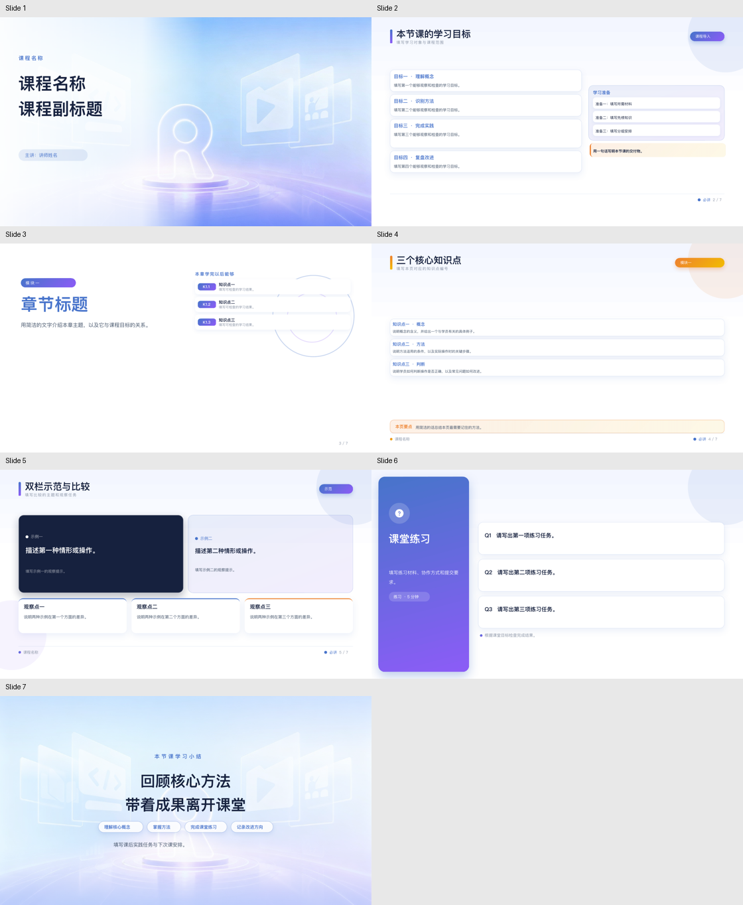
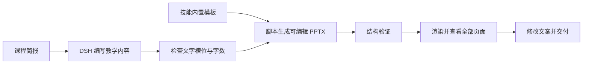

# 讲师课程 PPT 模版 Skill

**Instructor Course PPT Template Skill**

让 DSH 根据课程讲稿生成可编辑的 PPTX，并沿用 Lesson 教学版的蓝紫版式。

模型负责组织教学内容和编写文案，脚本负责复用原页面、填入文字及检查模板一致性。适合已有课程表、讲稿或教学大纲，希望制作统一风格课件的场景。

**日常使用看本页；AI 助手执行时读取 [SKILL.md](SKILL.md)。**

技能已内置七种可编辑版式、所需图片和可重新提取模板的 Lesson02 源文件。首次使用无需自行寻找原课件。

[下载完整技能 ZIP](https://github.com/EasonZhu1997/instructor-course-ppt-template-skill/releases/latest/download/course-ppt-template.zip) · [下载原始讲师模板及查看发布说明](https://github.com/EasonZhu1997/instructor-course-ppt-template-skill/releases/latest)



## 先看使用流程



输出的文字可以继续编辑，背景和装饰沿用源模板。它不会自动实现课件中讲授的应用、原型或服务器。

## AIUI 演示图什么时候用绿色

技能面向各类讲师课程，默认使用通用课件配色。讲授 **Rokid AIUI 单绿眼镜界面** 时，可以辅助准备或生成黑底绿字的界面示意图，绿色只出现在眼镜画面区域；Studio 工具截图、手机界面和其他课程不自动变绿。

优先采用实际截图或预览截图。宿主有图片生成工具时，可生成明确标注的教学概念图；没有绘图工具时，提供可复制提示词并说明尚未成图。`deepseek-flash` 的文字生成能力本身不等于图片生成能力。

当前固定版式引擎只有文字槽，辅助图作为独立配套素材交付，不会自动覆盖 PPT 中的文字或装饰。需要图片入稿时，应使用明确的图片槽或独立编辑流程，再检查完整页面。详见 [AIUI 演示图说明与 Hello AIUI 提示词](references/aiui-demo-visuals.md)。

## 三步开始使用

1. 下载上方技能 ZIP 并解压，得到 `course-ppt-template/` 文件夹。
2. 运行安装命令，复制完整技能到 DSH 用户技能目录：

   ```bash
   python3 course-ppt-template/scripts/install_skill.py
   ```

3. 打开已登录的 DSH，选择可用的 `deepseek-flash`，按下方示例给出课程要求。

安装时目标目录若已存在，脚本会拒绝合并。更新已有技能时加 `--replace`，脚本会先将旧目录保存在技能搜索根之外的 `skill-backups/` 中再安装，避免备份被重复发现；也可用 `--dest` 指定项目目录。模型调用需要你自己的 DSH 登录和可用额度，技能包不包含账号或密钥。

也可以通过 Git 下载并安装：

```bash
git clone https://github.com/EasonZhu1997/instructor-course-ppt-template-skill.git
python3 instructor-course-ppt-template-skill/scripts/install_skill.py
```

## 已安装后怎样调用

默认安装目录为 `~/.dsh/skills/course-ppt-template/`。模板随技能保存在 `assets/template.pptx`，不需要额外创建用户缓存。

### 方法一：在 DSH 对话中调用

选择当前账号可用的 `deepseek-flash`，然后提供课程资料和要求。例如：

```text
请使用 course-ppt-template 技能，为《Rokid AIUI 入门开发》制作10页中文PPT。

对象：第一次接触 AIUI 的开发者。
课时：60分钟。
主讲：课程讲师。
内容：AIUI Studio、项目与页面结构、最小应用、数据绑定、交互和预览调试。
交付：可编辑PPTX。

使用技能内置模板，保持课程版式。
若需要AIUI眼镜端画面，可辅助生成单绿界面示意图；只在该屏幕区域用绿色。
请读取完整SKILL.md，生成后执行结构验证，渲染并检查全部页面。
发现溢出时精简文案，不缩小字号。
```

课程资料里有课程名、学习对象、主要内容、课时、总页数、学员交付和不包含的内容，通常更容易得到合适的结果。指定的总页数包含封面和结尾。

### 方法二：用 CLI 生成

先把课程要求保存为 UTF-8 的 `.md` 或 `.txt` 简报。下面直接使用技能自带的通用示例：

```bash
COURSE_SKILL_DIR="$HOME/.dsh/skills/course-ppt-template"

python3 "$COURSE_SKILL_DIR/scripts/run_dsh.py" \
  --brief "$COURSE_SKILL_DIR/examples/rokid-aiui-intro-brief.md" \
  --output "$PWD/outputs/Rokid AIUI 入门开发.pptx" \
  --model deepseek-flash
```

`--brief` 读取文本简报，不能直接把 DOCX 当作 UTF-8 文本传入。课程表是 Word 文件时，先让助手读取相关课程，再整理成文本简报。

脚本使用 DSH 已有的本机账号登录，会访问模型服务并使用该账号的额度。它会生成课程内容、调用模板引擎，并独立执行结构验证；画面是否合格仍要查看渲染结果。已有输出文件会被拒绝覆盖，请换一个文件名。

| 参数 | 用途 |
| --- | --- |
| `--brief` | 必填，UTF-8 课程简报路径 |
| `--output` | 必填，新建的 `.pptx` 路径 |
| `--model` | 精确模型名称，默认 `deepseek-flash` |
| `--template` | 指定另一份兼容的模板缓存 |
| `--dsh-cli` | 自动查找失败时，指定 DSH 可执行文件 |
| `--timeout` | 本次 DSH 运行时限，默认 1200 秒 |
| `--dry-run` | 只准备本地调用文件，不调用模型，也不生成 PPT |

CLI 会在输出目录内的 `.work/dsh-…/` 保存内容 JSON、提示词、日志和运行记录。日志可能包含课程内容，分享技能时不要一起上传。

## 示例：Rokid AIUI 入门开发

随包示例以第一次接触 AIUI 的开发者为对象，覆盖 AIUI Studio、项目与页面结构、最小页面、数据绑定、交互、预览调试及课堂验收。

- [查看或下载 10 页示例 PPT](examples/rokid-aiui-intro.pptx)
- [课程简报](examples/rokid-aiui-intro-brief.md)
- [可重建课件的内容 JSON](examples/rokid-aiui-intro-content.json)
- [AIUI 眼镜演示图提示词](references/aiui-demo-visuals.md#示例提示词rokid-aiui-入门开发)

示例展示的是教学课件，未把代码讲解或预览检查写成已通过设备验收。需要配图时按上面的 AIUI 专用规则处理。

## 环境与模板选择

已验证环境为 macOS、Python 3.9.6、DSH CLI `0.2.1-rc.5`。模板引擎、安装脚本和 DSH 执行器只用 Python 标准库。画面渲染另需 LibreOffice 和 Poppler，Pillow 仅用于可选的联系图。其他系统、模型入口和 DSH 版本需重新验证。

执行器按下面的顺序选择模板：

1. 显式传入的 `--template`。
2. 当前技能目录内的 `assets/template.pptx`。
3. 兼容旧版安装的 `~/.dsh/course-ppt-template/template.pptx`。

内置模板与 [profile.json](references/profile.json) 配套。要查看默认调用会使用哪些文件，可在生成命令末尾加 `--dry-run`；它会写入本地准备文件，不调用模型、不生成 PPT。

DSH 路径会依次尝试显式的 `--dsh-cli`、PATH 中的 `dsh` 和 macOS 应用内置路径。自动查找失败时指定：

```bash
COURSE_SKILL_DIR="$HOME/.dsh/skills/course-ppt-template"

python3 "$COURSE_SKILL_DIR/scripts/run_dsh.py" \
  --brief "$COURSE_SKILL_DIR/examples/rokid-aiui-intro-brief.md" \
  --output "$PWD/outputs/新课程.pptx" \
  --dsh-cli "/你的DSH路径/dsh" \
  --model deepseek-flash
```

当前执行器固定使用 `deepseek-account` provider。`--model` 只切换这个账号支持的模型，不会切换到自定义 provider，也不会静默替换被拒绝的模型。其他支持文件读取、命令执行与图像查看的 AI 助手，可以按 `SKILL.md` 调用模板引擎；相应宿主尚未逐一验证。

## 原模板与图片在哪里

| 资源 | 位置与用途 |
| --- | --- |
| 可直接生成课件的七页模板 | [assets/template.pptx](assets/template.pptx)，包含通用填写提示 |
| 模板实际用到的背景和图标 | [assets/images/](assets/images/)，PPTX 内也已包含同一份资源 |
| Lesson02 原始源稿 | [assets/sources/lesson02-source.pptx](assets/sources/lesson02-source.pptx)，用于重新提取匹配的页面 |
| 原始讲师 PPT 模板 | [Releases 附件](https://github.com/EasonZhu1997/instructor-course-ppt-template-skill/releases/latest)，约 272 MiB，原文件完整保留 |
| 资源校验与来源记录 | [assets/manifest.json](assets/manifest.json) |

大号原始讲师模板保存在 Releases，日常生成无需下载它。内置模板已经包含所需图片，不依赖本机其他项目目录。素材的权利边界见 [ASSET_NOTICES.md](ASSET_NOTICES.md)。

### 需要重新提取模板时

通常无需执行此步骤。仅在修改 profile 或恢复缓存时，才从随包源稿提取一份新缓存：

```bash
COURSE_SKILL_DIR="$HOME/.dsh/skills/course-ppt-template"

python3 "$COURSE_SKILL_DIR/scripts/pptx_engine.py" bootstrap \
  --source "$COURSE_SKILL_DIR/assets/sources/lesson02-source.pptx" \
  --profile "$COURSE_SKILL_DIR/references/profile.json" \
  --output "$PWD/outputs/重新提取的模板.pptx"
```

之后通过 `--template` 显式选择新缓存。源课件不会被覆盖。其他版本的课件可能因页面或文字框 ID 不同而无法套用当前 profile，需要重新检查。

## 可以使用哪些页面

同一页型可以重复使用，七种页型不等于每份课件只能有七页。

| 页型 | 适合内容 | 已收紧的排版限制 |
| --- | --- | --- |
| `cover` | 封面、讲师 | 标题最多 3 行，每行最多 8 个字符 |
| `overview` | 四项目标、回顾和侧栏提示 | 每个文字框单独设预算 |
| `section` | 章节导语、三个学习目标 | 主标题单行，最多 6 个字符 |
| `concepts` | 三个知识点及总结 | 三条正文、总结正文均为单行；总结小标题最多 4 字 |
| `comparison` | 双栏示范与三个观察点 | 左右正文最多 2 行，分别每行最多 20、24 个字符 |
| `exercise` | 三道题或三项操作任务 | 左侧标题每行最多 6 个字符 |
| `closing` | 结课总结、四个产出标签 | 大标题最多 2 行，每行最多 12 个字符 |

完整限制以 [profile.json](references/profile.json) 为准。字符预算包括标点、英文和空格，不能仅凭“看起来不长”判断是否能放下。信息较多时先精简、调整页型或在允许的总页数内分页。

## 不调用模型，直接生成通用模板

技能附带一份使用填写提示的七页内容文件，可直接生成模板供手工编辑：

```bash
COURSE_SKILL_DIR="$HOME/.dsh/skills/course-ppt-template"

python3 "$COURSE_SKILL_DIR/scripts/pptx_engine.py" build \
  --template "$COURSE_SKILL_DIR/assets/template.pptx" \
  --profile "$COURSE_SKILL_DIR/references/profile.json" \
  --content "$COURSE_SKILL_DIR/examples/template-content.json" \
  --output "$PWD/outputs/通用教学模板.pptx"
```

若想编辑内容 JSON，可参考 [AIUI 入门开发示例](examples/rokid-aiui-intro-content.json) 和 [SKILL.md 的内容格式](SKILL.md#内容文件与生成)。所有非自动槽位必须填写，不能增加未知字段或保留空文字。

## 怎样检查课件

### 检查结构

`build` 成功时会执行结构检查，也可以单独再验证已有输出。`--content` 必须指向生成这份课件时使用的内容 JSON：

```bash
python3 "$COURSE_SKILL_DIR/scripts/pptx_engine.py" validate \
  --pptx "$PWD/outputs/通用教学模板.pptx" \
  --template "$COURSE_SKILL_DIR/assets/template.pptx" \
  --profile "$COURSE_SKILL_DIR/references/profile.json" \
  --content "$COURSE_SKILL_DIR/examples/template-content.json"
```

它核对文字内容、页序、内部关系、文字样式、页面几何、背景、媒体和共享母版/布局/主题。**通过结构验证不等于画面和教学内容都正确。**

### 渲染并查看画面

```bash
python3 "$COURSE_SKILL_DIR/scripts/render_review.py" \
  "$PWD/outputs/通用教学模板.pptx" \
  --out "$PWD/outputs/通用教学模板预览"
```

预览目录会生成 PDF、逐页 PNG 和 `review.json`；安装 Pillow 时还会生成联系图。需要复查部分页面时可加 `--pages 2,5-7`，最终交付仍应查看全部页面。

检查中文是否完整、文字是否越框或压住备注、标题是否合理换行、页码是否正确，以及内容是否覆盖课程表。界面和通讯实操课另看 [实操课程复核清单](references/practical-course-checks.md)。

渲染器可能用本机字体替代缺失字体，PPTX 本身保留参考字体。在 WPS/PowerPoint 中打开后，还应核对目标软件的显示效果。

## 常见问题

| 遇到的情况 | 处理方法 |
| --- | --- |
| 提示没有模板 | 检查是否下载、解压并安装了完整技能包，`assets/template.pptx` 应存在；不要只复制 SKILL.md |
| 模板与 profile 不兼容 | 重新安装同一发布版本的完整文件，或用随包源稿重新提取，不混用不同版本 |
| 提示缺少、未知或空槽位 | 按 profile 补齐该页全部非自动字段，删除多余字段 |
| 字数、行数超限 | 缩短对应文案或调整分页，不修改限制来硬塞 |
| 提示输出已存在 | 新建文件名；`run_dsh.py` 没有 `--force`，仅引擎的导入/生成命令支持明确替换生成物 |
| 找不到 DSH | 用 `--dsh-cli` 指定可执行文件；可先用 `--dry-run` 检查本地准备 |
| 模型名被拒绝 | 使用当前账号实际支持的名称；本次验证名称为 `deepseek-flash` |
| `flash1017` 能否直接使用 | 2026-11-05 实测该名称及 `deepseek-flash1017` 被当前账号拒绝，不能假定与 `deepseek-flash` 等同 |
| 中文缺字或显示为方框 | 检查渲染字体，必要时传 `--font-file`；不要将缺字预览当成完成 |
| 找不到 LibreOffice/Poppler | 安装相应工具，或用 `--soffice`、`--pdftoppm` 指定路径 |
| 结构检查通过，画面仍有问题 | 查看全部渲染页并修改文案；结构检查无法证明没有裁切或教学逻辑错误 |

## 已验证范围与文件导航

2026-11-05 已使用 DSH `deepseek-flash` 测试多门通用课程及界面/通讯实操课，发布示例统一采用《Rokid AIUI 入门开发》。真实模型生成后经过内容审校和全页画面检查；这些记录不代表所有新课程都能免审交付。详见 [验证记录](references/validation.md)。

| 文件 | 用途 |
| --- | --- |
| [SKILL.md](SKILL.md) | AI 助手执行说明 |
| [install_skill.py](scripts/install_skill.py) | 安装完整技能，更新前保留备份 |
| [profile.json](references/profile.json) | 七类页面、文字槽位和预算 |
| [设计说明](references/design-notes.md) | 模板来源、参考差异、已知原稿问题 |
| [实操复核清单](references/practical-course-checks.md) | 界面流转、通讯概念和课堂步骤检查 |
| [AIUI 演示图说明](references/aiui-demo-visuals.md) | 仅眼镜端画面使用单绿、截图与生成边界及提示词 |
| [验证记录](references/validation.md) | 本次实际验证范围及限制 |
| [run_dsh.py](scripts/run_dsh.py) | 调用本机 DSH 生成课件 |
| [pptx_engine.py](scripts/pptx_engine.py) | 导入模板、填充内容、验证结构 |
| [render_review.py](scripts/render_review.py) | 导出 PDF/PNG 供画面复核 |

仓库随包提供经本次授权分享的课件模板、所需图片及指定源稿；原始讲师模板另附于 Releases。代码采用 [MIT License](LICENSE)，课件、品牌图形与第三方素材保留各自权利，详见 [素材说明](ASSET_NOTICES.md)。不包含登录凭据、字体安装包或用户后续课程及运行日志。
